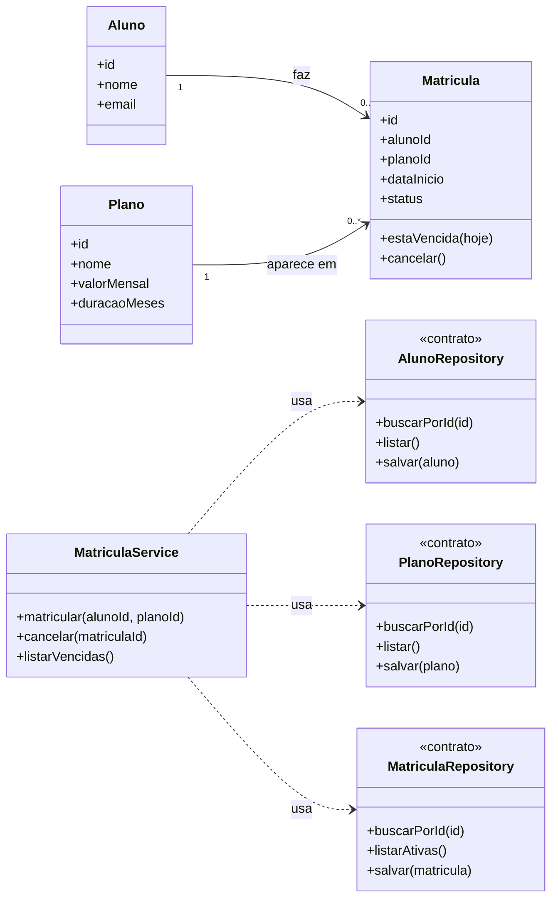

# Modelagem — Projeto 1

**Aluno(a):** Pedro Henrique Guimarães
**Domínio:** Controle de matrículas de uma academia

## 1. O domínio

A academia oferece planos (mensal, trimestral, anual) e matricula alunos neles.
Cada matrícula registra qual aluno contratou qual plano e a partir de quando.
Um aluno só pode ter uma matrícula ativa por vez.

## 2. Entidades

| Entidade  | Atributos                                | Relacionamentos                  |
| --------- | ---------------------------------------- | -------------------------------- |
| Aluno     | id, nome, email                          | faz várias matrículas            |
| Plano     | id, nome, valorMensal, duracaoMeses      | aparece em várias matrículas     |
| Matricula | id, alunoId, planoId, dataInicio, status | pertence a um aluno e a um plano |

## 3. Diagrama de classes

## 4. Responsabilidades

| Classe                                                | Papel            | Único motivo para mudar                                              |
| ----------------------------------------------------- | ---------------- | -------------------------------------------------------------------- |
| Aluno, Plano, Matricula                               | entidades        | as regras do próprio objeto (ex.: quando uma matrícula está vencida) |
| MatriculaService                                      | regra de negócio | o processo de matricular e cancelar                                  |
| AlunoRepository, PlanoRepository, MatriculaRepository | acesso aos dados | a forma de guardar (memória na S3, SQLite na S5)                     |

## 5. Onde apliquei SRP e DIP

- **SRP:** nenhuma entidade salva a si mesma nem envia e-mail. Guardar é papel dos repositories; o processo de matricular e cancelar fica no MatriculaService.
- **DIP:** o MatriculaService depende dos contratos dos repositories, recebidos pelo construtor. Ele não sabe se os dados estão em memória ou em um banco.

## 6. Fora do escopo (YAGNI)

Login, pagamento, controle de frequência e relatórios não entram no Projeto 1.
